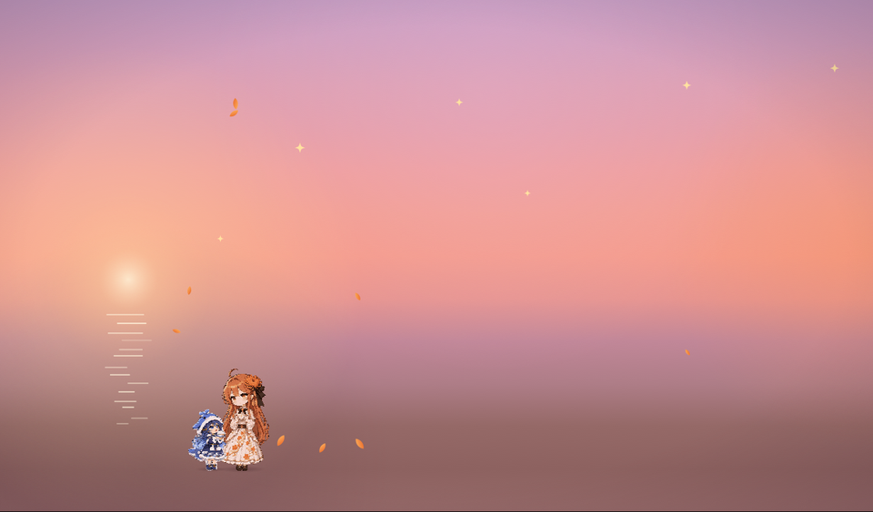
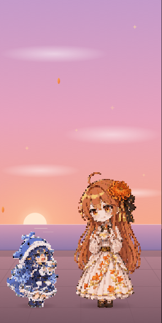

# 大小姐的下午茶 · ojousama-teatime

Claude 大小姐 × DeepSeek 大肥鱼的二次元皮肤，给 Claude Code 桌面版用的 mod。非官方同人二创。

A fan-made anime skin for the Claude Code desktop app: Claude-ojousama and DeepSeek's chubby whale girl at a seaside teatime.

| 背景 | 侧边小舞台 |
| --- | --- |
|  |  |

## 有什么

- **背景**：黄昏的海边，深色模式下换成夜景。大小姐捧着茶杯，大肥鱼捧着一碗白米饭，站在侧边栏和对话栏之间那条空白里，位置和大小可以调。
- **侧边小舞台**：`/ojou pane` 打开一个竖版面板。两人在里面会动：大小姐的头发和裙摆慢慢摆，大肥鱼捧着饭蹦两下，菊花瓣飘落，星星和波光闪烁，两人头顶轮流冒出对话。面板越高，露出的天空越多。
- **聊天装饰**：Claude 的回复旁是大小姐的像素头像，你的消息旁是大肥鱼；输入框上方有两人的头像和一句每轮换一次的台词；工作中那一行和输入框下面的提示行带一句小字，比如“大小姐思考中”；状态栏写着这次陪你几轮。
- **配色**：浅色是奶油桃色，深色是夜海蓝；强调色用橙色，代码里的字面量用鲸鱼的蓝色。

## 安装

在终端里的 Claude Code 会话中输入：

```
/plugin install ojousama-teatime --marketplace songwait/ojousama-teatime
```

问 `Add marketplace?` 时回答 `y`，再选安装范围（默认第一个，用户范围）。

在 shell 里：

```bash
claude plugin install ojousama-teatime --marketplace songwait/ojousama-teatime
```

在桌面版里（那里没有 `/plugin`）：点输入框旁边的 +，选 Plugins，用 Add marketplace 添加 `songwait/ojousama-teatime`，再 Add plugin。

装好以后在桌面版的会话里输入 `/ojou` 看当前设置和全部命令。

## 命令

| 命令 | 作用 |
| --- | --- |
| `/ojou` | 显示当前设置和用法 |
| `/ojou live` / `/ojou off` | 打开 / 关闭皮肤 |
| `/ojou move N` | 两人离窗口左边多远，占窗口宽度的百分比（0–85，默认 22） |
| `/ojou size N` | 两人多高，占窗口高度的百分比（5–80，默认 20） |
| `/ojou pane` / `/ojou pane off` | 打开 / 关上侧边小舞台；开着的话，下次开会话会自动打开 |
| `/ojou deco on` / `/ojou deco off` | 打开 / 关闭聊天装饰 |

设置都会记住。侧边栏展开时，左边那条空白会往右移，用 `/ojou move` 把两人挪过去；侧边栏收起时可以调小，比如 `/ojou move 6`。

## 已知限制

- 背景和小舞台只在桌面版里画得出来；在终端里只有台词、小字和状态栏。
- 桌面版把背景当成一张静止的图来画：里面的 CSS 和 SMIL 动画都不会动；嵌在 SVG 里的图片会被拦掉；用定时重画能动，但每次都会闪。所以背景是静止的，会动的是侧边小舞台（面板里的 SVG 能跑 SMIL 动画）。
- 两个人都是用矢量色块拼的细像素画，因为桌面版的背景和面板都不显示嵌入的图片。
- 小舞台的大小是按面板的字符数估算的（每个字符约 9 像素、每行约 19 像素）。窗口比例特殊时，可能会多出一点或少一点。

## 素材是怎么做的

人物和场景图用图像模型生成，参考了网上流行的 Claude 大小姐、DeepSeek 大肥鱼的同人形象。动作帧表用 Aseprite 切帧、对齐，锁住每帧的头部防止闪烁，再缩成细像素，最后转成 SVG 路径。原图、Aseprite 工作文件、像素帧和生成脚本都在 [`source/`](source/)，说明见 [`source/README.md`](source/README.md)。

## 声明

非官方同人作品，与 Anthropic、DeepSeek 没有关系。Claude 是 Anthropic 的商标，DeepSeek 是深度求索的商标。

## 许可

[MIT](LICENSE)
